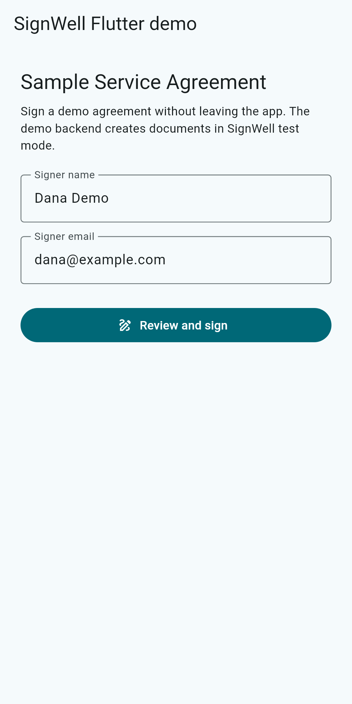
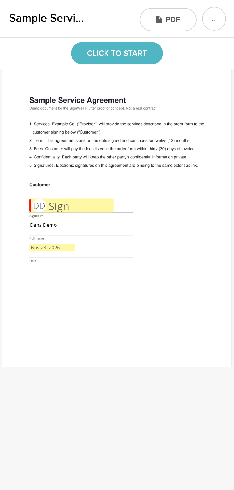

# SignWell embedded signing in Flutter (proof of concept)

SignWell doesn't have a Flutter SDK, and you don't need one. This sample shows a signer completing a SignWell document **inside a Flutter app**, using SignWell's [embedded signing](https://developers.signwell.com/reference/embedded-iframe) in a WebView.

<p>
  
  
</p>

## How it works

```
Flutter app ──POST /signing-sessions──▶ Your backend ──POST /api/v1/documents──▶ SignWell
     ▲                                        │   (holds the API key)
     │◀──────── embedded_signing_url ─────────┘
     │
     ▼
WebView: local HTML page + embedded.js ──events──▶ Flutter (JavaScriptChannel)
                                                  completed / declined / closed / error
SignWell ──document_completed webhook──▶ Your backend (source of truth)
```

1. **Your backend creates the document** with `embedded_signing: true` and returns the recipient's `embedded_signing_url`. The SignWell API key stays on the server, so it never ships in the app.
2. **The app opens a WebView** with a small bundled HTML page ([`app/assets/signwell_signing.html`](app/assets/signwell_signing.html)) that loads `https://static.signwell.com/assets/embedded.js` and opens the signing URL.
3. **embedded.js events go to Flutter** through a `JavaScriptChannel`: `completed`, `declined`, `closed` and `error`. The signing screen closes and returns the event.
4. **Your backend confirms** using the API or the `document_completed` webhook before you treat the document as signed.

## Run it

You need Flutter 3.50+ (Dart 3.14+) and a SignWell account. Test mode is free.

```sh
# 1. Backend (Dart)
cd backend
cp .env.example .env        # add your SIGNWELL_API_KEY
dart pub get
dart run bin/server.dart    # http://localhost:8080

# 2. App (in another terminal)
cd app
flutter pub get
flutter run                                                     # Android emulator (uses http://10.0.2.2:8080)
flutter run --dart-define=BACKEND_URL=http://localhost:8080     # iOS simulator
```

Tap **Review and sign**, sign the sample agreement, and the app shows the status SignWell reports (`Completed`). The signed PDF is at `GET /documents/<id>/signed.pdf` on the backend.

## Use it in your app

Copy `app/lib/src/signing_screen.dart`, `app/lib/src/signwell_bridge.dart` and `app/assets/signwell_signing.html` (and list the asset in `pubspec.yaml`). Then:

```dart
final event = await Navigator.of(context).push<SignWellEvent>(
  MaterialPageRoute(builder: (_) => SigningScreen(signingUrl: urlFromYourBackend)),
);
if (event?.type == SignWellEventType.completed) {
  // Update the UI, then confirm with your backend.
}
```

Dependencies: `webview_flutter` and `url_launcher` (for links that try to leave the signing page).

## Things that matter

- **Never put your API key in the app.** Anything in an app binary can be extracted. Create documents server-side and only send the signing URL to the device. Authenticate your app users so one user can't request another user's signing URL.
- **Give the local page an https base URL.** The sample calls `loadHtmlString(html, baseUrl: signingPageBaseUrl)`. Without a base URL the page has an opaque `about:blank` origin, and in our testing the SignWell iframe loaded but rendered blank. Set `--dart-define=SIGNING_PAGE_BASE_URL=https://your-domain/`. Nothing is fetched from that URL; it only gives the page an origin.
- **Handle every outcome, not only `completed`.** Signers can decline (`declined` includes their reason), close, or hit an error.
- **The in-app event is for the UI; the webhook is the source of truth.** Register a webhook (`POST /api/v1/hooks`) pointing at `/webhooks/signwell`, and set `SIGNWELL_WEBHOOK_ID` so the backend verifies each event (HMAC-SHA256 of `type@time`, keyed by the webhook ID; see [event hash verification](https://developers.signwell.com/reference/event-hash-verification)). The hash doesn't cover the event data, so the sample re-fetches the document from the API after verifying.
- **The signed PDF can take a few seconds.** Right after completion, `GET /documents/{id}/completed_pdf` can briefly return 404. The backend retries.
- **Using templates?** Set `SIGNWELL_TEMPLATE_ID` and `SIGNWELL_TEMPLATE_PLACEHOLDER` and the backend uses `POST /api/v1/document_templates/documents` instead of the bundled PDF.
- **Test mode** documents are free and watermarked "not legally valid". Set `SIGNWELL_TEST_MODE=false` for production.
- **Attachment fields:** Android's WebView doesn't open a file picker for `<input type="file">` unless you add one (`webview_flutter_android`'s `setOnShowFileSelector`). This sample doesn't use attachment fields.

## Project layout

```
backend/   Dart (shelf) server: creates documents, status, signed PDF, webhook receiver
  lib/signwell_client.dart   tiny SignWell API client (X-Api-Key)
  lib/documents.dart         document request with signature/name/date fields
  lib/webhooks.dart          webhook event hash verification
app/       Flutter app
  lib/src/signing_screen.dart   WebView signing screen (reusable)
  lib/src/signwell_bridge.dart  event parsing + page builder
  assets/signwell_signing.html  page that loads embedded.js
```

Tests: `cd backend && dart test`, `cd app && flutter test`.

## Links

- [Embedded signing (iFrame) reference](https://developers.signwell.com/reference/embedded-iframe)
- [SignWell API reference](https://developers.signwell.com/)
- Native Android and iOS samples (2023) using the same approach: [signwell-native-android-poc](https://github.com/Bidsketch/signwell-native-android-poc), [signwell-native-ios-poc](https://github.com/Bidsketch/signwell-native-ios-poc)

This is a sample, not a supported SDK.
